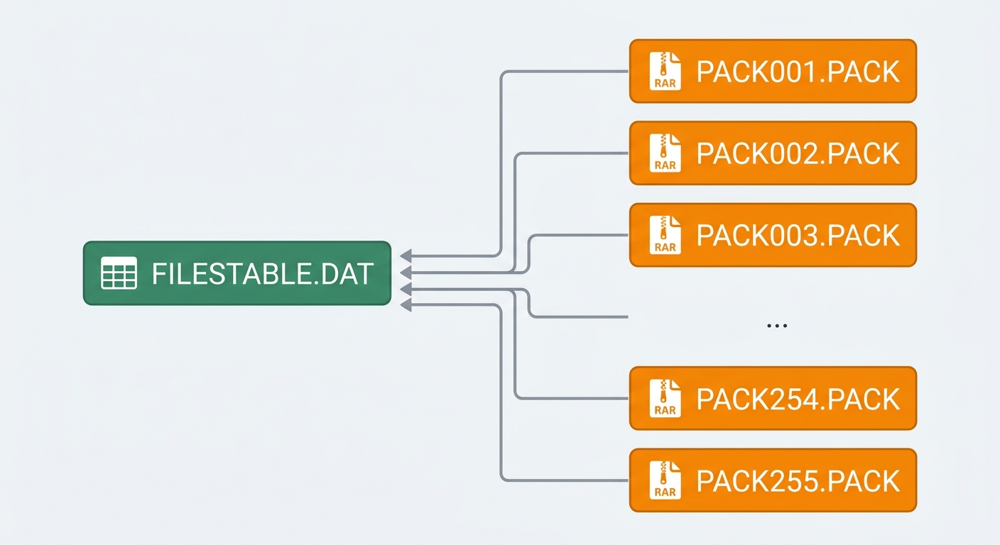

# PGP.VFS - Виртуальная файловая система для игровых ресурсов

[](LICENSE)
[](https://dotnet.microsoft.com/ru-ru/download/dotnet/9.0)

## Производительная виртуальная файловая система на .NET 10, предназначенная для упаковки (с возможностью сжатия) и быстрого чтения ассетов.

## Проект создавался с упором на максимальную скорость чтения в рантайме, а не на время упаковки.

## Пример использования

```
using PGP.VFS;
using Microsoft.Extensions.Logging.Abstractions;

// Sample files structure: 
// MyGames/
// |-- Sources/
// |   |-- Textures/
// |   |   |-- someTexture1.dds
// |   |   \-- someTexture2.dds
// |   |-- Audio/
// |   |   |-- someAudio1.wav
// |   |   \-- someAudio2.wav
// |   |-- Models/
// |   |   |-- someModel1.obj
// |   |   \-- someModel2.obj
// |-- Packed/
// |   |--FILESTABLE.DAT
// |   \-- PACK001.PACK


// Создание VFS в режиме SOURCES
var vfs = await VFS.CreateAsync("C:/MyGame/Sources", "C:/MyGame/Packed", NullLogger<VFS>.Instance);

// Добавление файлов
Guid compressedFile1Id = await vfs.AddFile("Textures/someTexture1.dds", VFSFileFlags.IsCompressed);
Guid compressedFile2Id = await vfs.AddFile("Models/someModel1.obj");

Guid uncompressedFileId = await vfs.AddFile("Audio/someAudio2.wav", VFSFileFlags.None);

// Сохранение таблицы и упаковка
await vfs.PackAsync(compressionLevel: 15);

// Закрываем VFS
await vfs.DisposeAsync();

// Открытие в режиме PACKS (для конечного пользователя)
vfs = await VFS.OpenAsync(VFSMode.PACKS, "C:/MyGame/Sources", "C:/MyGame/Packed", NullLogger<VFS>.Instance);

// Получение потока файла
using Stream stream = vfs.GetFileStream(fileId);
using var fileOutput = File.Create("extracted_texture.dds");
stream.CopyTo(fileOutput);

// Закрываем VFS
await vfs.DisposeAsync();
```

## Ключевые особенности

* Ассеты упаковываются в архивы (паки). Каждый ассет всегда находится в одном паке
* Ассет доступен по `GUID`. Также в метаданных хранится относительный путь исходного файла
* Использзование FlatBuffers для хранения файловой таблицы
* Ограничениия:
  * Можно создать до **254** паков
  * Размер каждого пака: до **2<sup>32</sup> - 1** байт ~ **4** ГБ
  * Всего VFS может вместить до **(2<sup>32</sup> - 1) * 254** байт ~ **1 ТБ** данных
* Есть опция сжатия ассетов с помощью ZstdSharp
* Чтение данных происходит напрямую с диска в память программы без промежуточных аллокаций
* Реализован безопасный процесс дефрагментации с исспользованием буферного файла
* Есть 2 режима работы:
  ** `SOURCES` - режим, в котором чтение ассетов происходит из исходников, а не из паков. Нужен для разработки, чтобы каждый раз не ждать сборки VFS 
  ** `PACKS` - режим, в котором чтение ассетов происходит из паков

## Производительность 

Замеры проводились на процессоре Intel Core i5-13450HX. Чтение файла размером 1 МБ.

|Операция	|Время (Mean)	|Выделено памяти	|
| :---		|:---			|		:---		|
|Поиск файла|28 нс			| 0 B				|
|Открытие потока файла (без сжатия)| 39 нс| 104 B| 
|Открытие потока файла (сжатого)| 223 нс | 248 B |
|Полное чтение файла (без сжатия)| 77 мкс | 104 B|
|Полное чтение файла (сжатого)   | 259 мкс | 249 B|

Пропускная способность: **~12.9 ГБ/с** для несжатых данных и **~3.86 ГБ/с** для сжатых (включая декомпрессию Zstd).

## Структура файлов



### Файловая таблица (файл FILESTABLE.DAT)

Таблица файлов и их метаданных.
Содержит GUID файла, относительный путь исходника, смещение и размер файла в паке, дата и время создания и изменения файла.

### Пак (файлы PACK{индекс пака от 1 до 255}.PACK)

Файл, в котором последовательно, без пробелов и выравниваний, записаны ассеты.

## Архитектурные решения

### Безопасное чтение пака через SafeFileHandle

После инициализации в режиме `PACKS`, на каждый файл пака открывается SafeFileHandle. Можно читать из одного пака параллельно в несколько потоков.  

### Алгоритм упаковки

Файлы сортируются от большего к меньшему. Система проверяет, влезет ли файл в текущий пак (учитывая `ZstdSharp.Compressor.GetCompressBoundLong`, если включено сжатие). Если не влезает - создается новый пак.
Далее, если нужно, сжимаем файл, затем записываем в пак.

### Удаление файлов

При удалении файла (метод `DeleteFile`) он помечается флагом IsDeleted, но физически остается в паке.
Дефрагментация проходит по пакам, собирает "живые" файлы подряд, записывает их в буферный файл, после чего старый пак удаляется, а буферный переименовывается.
Если процесс прервется, VFS при следующем старте продолжит дефрагментацию, начиная с пака, на котором процесс остановился.

## Компиляция

* Framework: .NET 10.0
* Dependencies:
  ** ZstdSharp 0.8.8
  ** Google.FlatBuffers 25.2.10
  ** FlatBuffers schemas [PGP.Shared](https://github.com/YurijChetverikov/PGP_Shared)